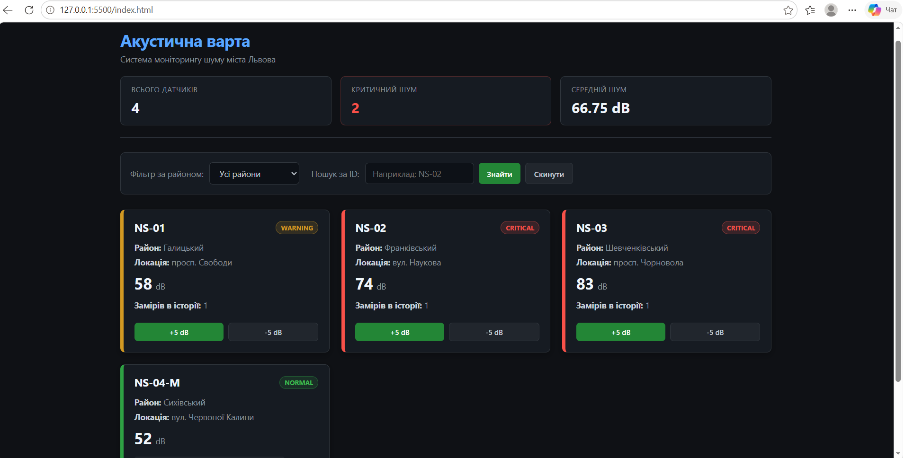
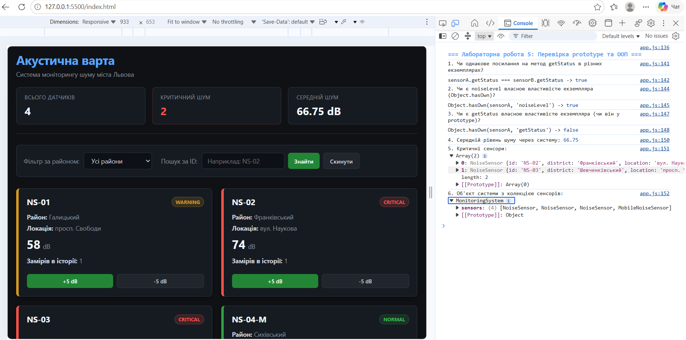
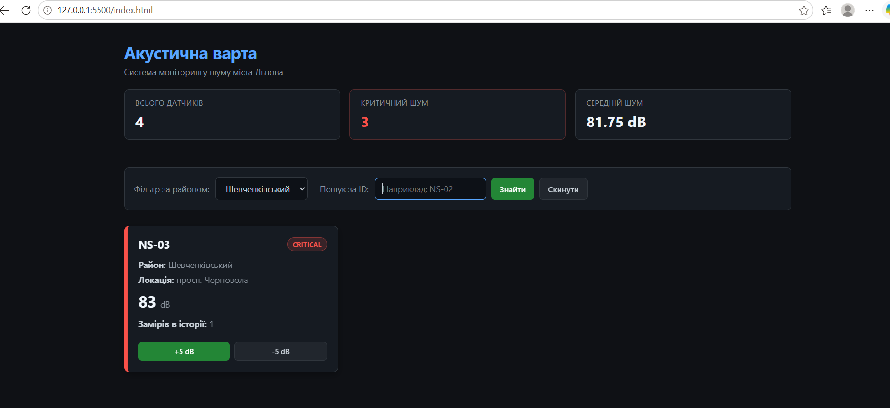

# Звіт до лабораторної роботи №5

## Тема

Проєктування системи класів у JavaScript на прикладі проєкту «Акустична варта».

## Мета роботи

Навчитися переходити від набору окремих функцій до спроєктованої системи взаємопов'язаних класів: виділяти сутності предметної області, визначати їх стан і поведінку, будувати композицію та наслідування.

## Виконання роботи

- розділено JavaScript на окремі файли за відповідальністю: `models/`, `services/`, `app.js`;
- реалізовано клас `NoiseSensor` з полями `id`, `district`, `location`, `noiseLevel`, `measurements` та методами `getStatus()`, `updateNoiseLevel()`, `addMeasurement()`;
- централізовано межі класифікації шуму в константі `NOISE_LIMITS` — числа 55 і 70 не дублюються;
- реалізовано static-метод `isValidNoiseLevel()` для перевірки значення без конкретного екземпляра;
- реалізовано static-метод `fromObject()` для створення екземпляра з plain object;
- реалізовано клас `NoiseMeasurement` з полями `value`, `measuredAt` та методом `isValid()`;
- реалізовано клас `MonitoringSystem` з методами `addSensor()`, `findSensorById()`, `getSensorsByDistrict()`, `getCriticalSensors()`, `getAverageNoiseLevel()`;
- реалізовано підклас `MobileNoiseSensor extends NoiseSensor` з полем `batteryLevel` та методом `needsCharging()`;
- створено три сенсори з початкових даних через `NoiseSensor.fromObject()` та передано в `MonitoringSystem`;
- реалізовано функцію `renderSensorCard(sensor)` яка створює DOM-картку з CSS-класом статусу;
- картки сенсорів відображаються на сторінці з кольоровим маркуванням: `normal`, `warning`, `critical`.

### Результати виконання лабораторної роботи

1. Скріншот 1:

2. Скріншот 2:

3. Скріншот 3:

## Висновок

Під час виконання лабораторної роботи реалізовано систему класів для проєкту «Акустична варта». Клас `NoiseSensor` інкапсулює стан і поведінку датчика, `MonitoringSystem` керує колекцією датчиків і виконує агрегацію. Використано композицію `MonitoringSystem → NoiseSensor[]` та наслідування `MobileNoiseSensor extends NoiseSensor`. Бізнес-правила класифікації шуму