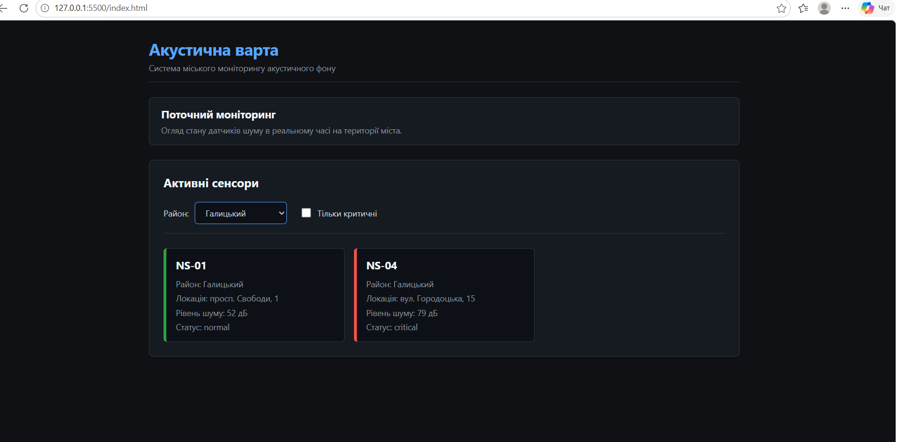
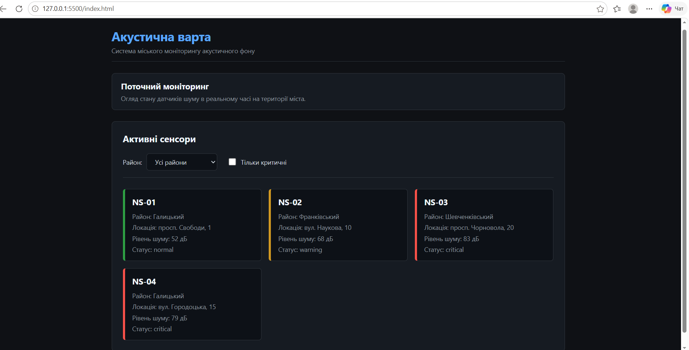
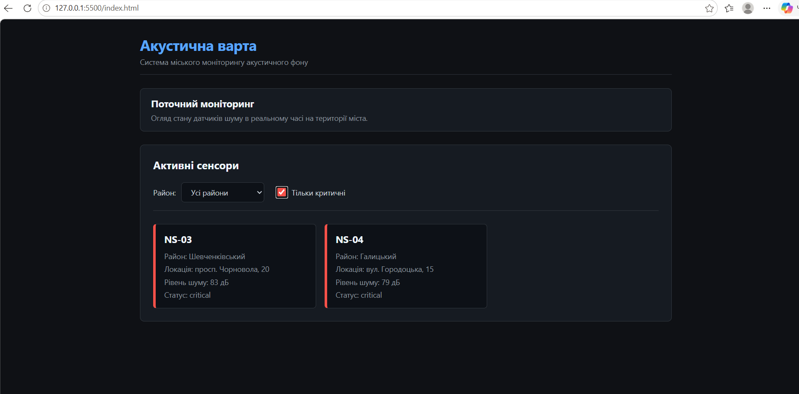

# Звіт до лабораторної роботи №6

## Тема

Відображення та фільтрація сенсорів у DOM на прикладі проєкту «Акустична варта».

## Мета роботи

Навчитися відображати дані сенсорів на існуючій сторінці та фільтрувати їх за районом і статусом засобами JavaScript.

## Виконання роботи

- додано секцію «Активні сенсори» після блоку «Поточний моніторинг»;
- реалізовано два фільтри: `select` для вибору району та `checkbox` «Тільки критичні»;
- отримано DOM-елементи через `querySelector()`: `.sensor-list`, `#district-filter`, `#critical-filter`;
- реалізовано функцію `createSensorCard(sensor)` — створює `article` з класом `sensor-card--${sensor.getStatus()}`;
- реалізовано функцію `renderSensors(sensorArray)` — очищує список через `replaceChildren()` і додає картки;
- реалізовано функцію `applyFilters()` — фільтрує масив сенсорів за районом і статусом через `filter()`;
- додано `addEventListener("change", applyFilters)` на обидва фільтри;
- картки отримують CSS-клас статусу: `sensor-card--normal`, `sensor-card--warning`, `sensor-card--critical`;
- використано об'єкти `NoiseSensor` з попередньої роботи та метод `getStatus()`.

### Результати виконання лабораторної роботи

1. Фільтрація за районом:

2. Початковий стан (усі сенсори):

3. Фільтрація тільки критичних сенсорів:

## Висновок

Під час виконання лабораторної роботи реалізовано відображення та фільтрацію сенсорів у DOM. Використано `querySelector()` для пошуку елементів, `createElement()` і `append()` для створення карток, `replaceChildren()` для очищення списку перед повторним рендерингом. Фільтрація реалізована через метод `filter()` з одночасною перевіркою двох умов. Події фільтрів оброблено через `addEventListener("change")`.