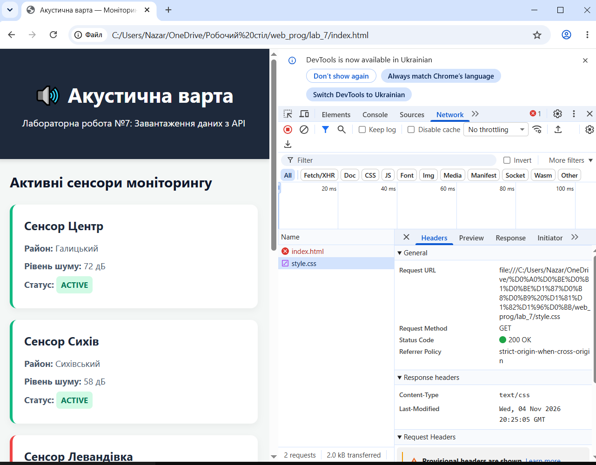
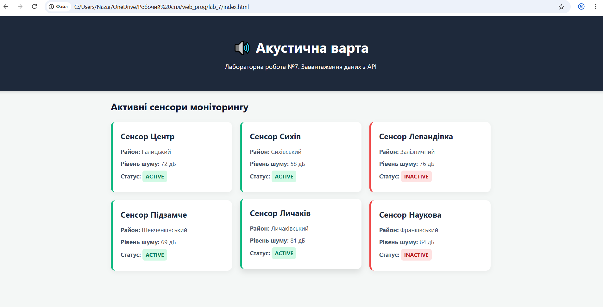
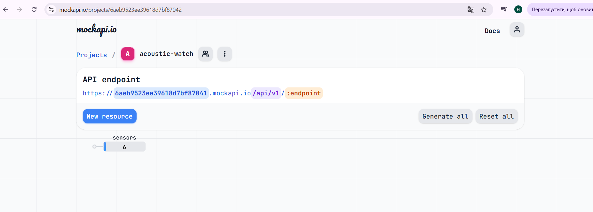

# Звіт до лабораторної роботи №7

## Тема

Завантаження даних з публічного API та відображення на сторінці на прикладі проєкту «Акустична варта».

## Мета роботи

Навчитися отримувати дані з REST API та відображати їх у DOM:

- пояснити що таке API та endpoint;
- виконати HTTP GET-запит за допомогою `fetch()`;
- отримати об'єкт Response та перевірити `response.ok` і `response.status`;
- перетворити JSON-відповідь у масив JavaScript через `response.json()`;
- передати масив у функцію відображення та створити картки сенсорів у DOM;
- перевірити API-запит у DevTools → Network та обробити помилку завантаження.

## Виконання роботи

- створено тестовий REST API у сервісі MockAPI з prefix `/api/v1` та ресурсом `sensors`;
- додано 6 тестових сенсорів із полями `id`, `name`, `district`, `noiseLevel` (Number), `status` (String);
- перевірено endpoint у браузері — повертає JSON-масив зі статусом 200;
- додано контейнер `
` у HTML для вставки карток;
- створено файл `fetch_sensors.js` із константою `API_URL`;
- реалізовано асинхронну функцію `loadSensors()` — виконує GET-запит через `fetch()`, перевіряє `response.ok`, перетворює відповідь через `response.json()` та передає масив у `renderSensors()`;
## Скриншоти виконання
  
  
  

## Висновок

Під час виконання лабораторної роботи реалізовано завантаження даних із публічного REST API та їх відображення у DOM. Використано `fetch()` для виконання GET-запиту, `response.ok` для перевірки статусу відповіді та `response.json()` для перетворення JSON у масив JavaScript. Функція `renderSensors()` відповідає лише за відображення, отримуючи готовий масив через параметр. Обробку мережевих помилок реалізовано через `try/catch`. Запит перевірено у DevTools → Network.