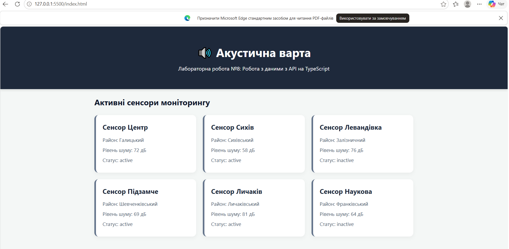

# Звіт до лабораторної роботи №8

## Тема

Перехід на TypeScript та типізація даних для проєкту «Акустична варта».

## Мета роботи

Освоїти використання TypeScript у вебпроєктах для підвищення надійності коду та безпеки типізації:

- налаштувати середовище TypeScript (`tsconfig.json`, компіляція з папки `src` у `dist`);
- створити інтерфейси (`interface Sensor`) для типізації даних із REST API;
- виконати асинхронний запит та обробити типи даних із використанням `async/await` і `fetch()`;
- реалізувати генерацію DOM-елементів та карток сенсорів на основі типізованих даних;
- перевірити роботу скомпільованого коду за допомогою локального сервера (Live Server).

## Виконання роботи

- ініціалізовано npm-окруження (`npm init -y`) та встановлено компілятор TypeScript (`npm install -D typescript`, `npx tsc --init`);
- налаштовано конфігураційний файл `tsconfig.json` з параметрами `rootDir: "./src"` та `outDir: "./dist"`;
- створено файл `src/sensors.ts`, де оголошено інтерфейс `interface Sensor` із полями `id`, `name`, `district`, `noiseLevel` (number) та `status` ("active" | "inactive");
- реалізовано асинхронну функцію `loadSensors()`, яка виконує GET-запит до MockAPI (`https://6aeb9523ee39618d7bf87041.mockapi.io/api/v1/sensors`), перевіряє `response.ok` та обробляє можливі помилки через `try/catch`;
- реалізовано функцію `renderSensors(sensors: Sensor[])`, яка очищує контейнер `#sensors`, перебирає масив і динамічно створює HTML-картки для кожного сенсора;
- виконано компіляцію коду з TypeScript у JavaScript за допомогою команди `npx tsc`;
- підключено скомпільований скрипт (`<script type="module" src="./dist/sensors.js">`) у файлі `index.html` та проєкт запущено через локальний сервер (Live Server).

## Результат: 
  

## Висновок: 
Під час виконання лабораторної роботи закріплено навички міграції вебпроєктів на TypeScript. Використання інтерфейсів (interface Sensor) дозволило забезпечити сувору типізацію даних, що надходять із зовнішнього REST API, уникнути потенційних помилок під час розробки та успішно скомпілювати код у сучасні ES-модулі для виконання в браузері.
