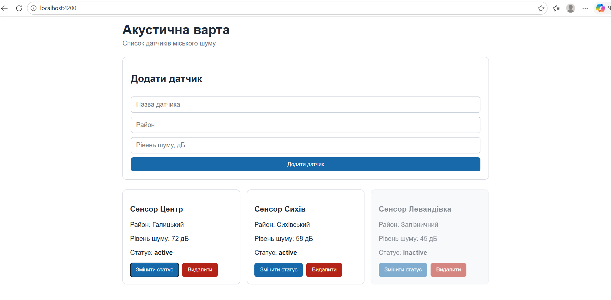
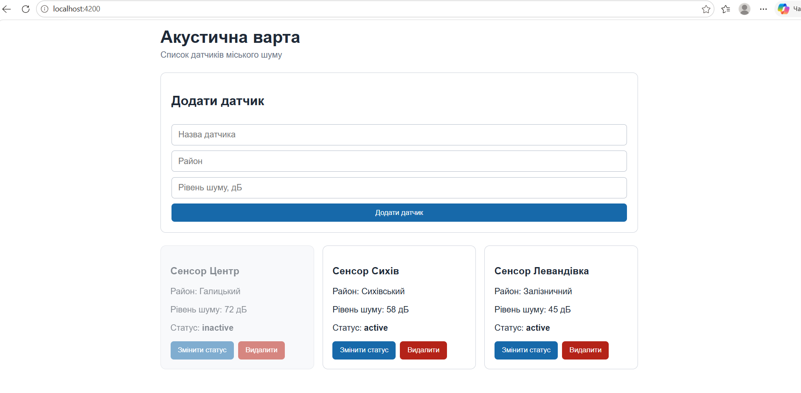
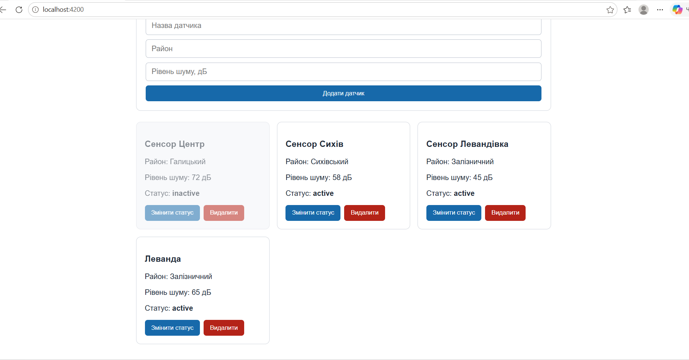

# Звіт до лабораторної роботи №9

## Тема

Створення простого Angular-застосунку («Todo list») на прикладі проєкту «Акустична варта».

## Мета роботи

Навчитися створювати простий Angular-застосунок, працювати з компонентом і шаблоном, відображати список даних, обробляти натискання кнопок, виконувати production build та готувати застосунок до публікації.

- ознайомитися з основою Angular CLI та структурою standalone-застосунку;
- створити модель даних `Sensor` для типізації об'єктів датчиків;
- налаштувати основний компонент застосунку (`AppComponent`);
- реалізувати відображення списку датчиків за допомогою директиви `@for`;
- створити форму для додавання нових датчиків з двостороннім зв'язуванням через `[(ngModel)]`;
- реалізувати функціонал видалення датчика та перемикання його статусу (`active` / `inactive`);
- налаштувати візуальне стилювання карток та форми за допомогою CSS;
- виконати production-збірку проєкту за допомогою `ng build` та перевірити роботу статичних файлів з папки `dist`.

## Виконання роботи

1. **Встановлення інструментів та ініціалізація проєкту:**
   - Встановлено Angular CLI глобально за допомогою npm-команди `npm install -g @angular/cli`.
   - Згенеровано новий standalone-проєкт Angular без додаткової маршрутизації та тестів командою:
     ```bash
     ng new acoustic-watch --routing=false --style=css --skip-tests
     ```

2. **Створення моделі даних:**
   - У папці `src/app/` створено файл `sensor.ts` з описом інтерфейсу `Sensor`:
     ```typescript
     export interface Sensor {
       id: number;
       name: string;
       district: string;
       noiseLevel: number;
       status: 'active' | 'inactive';
     }
     ```

3. **Розробка логіки компонента (`src/app/app.component.ts`):**
   - Імпортовано `FormsModule` для роботи з формулярами та `[(ngModel)]`.
   - Створено початковий масив `sensors` із трьох об'єктів-датчиків.
   - Реалізовано методи:
     - `addSensor()` — додавання нового датчика на основі введених у форму даних та генерації унікального `id`;
     - `deleteSensor(id)` — видалення датчика зі списку за допомогою фільтрації масиву;
     - `toggleStatus(id)` — зміна стану датчика між `active` та `inactive`.

4. **Розробка шаблону (`src/app/app.component.html`):**
   - Створено форму з полями введення (назва, район, рівень шуму) та кнопкою «Додати датчик».
   - Реалізовано динамічний вивід карток через новий Angular синтаксис `@for (sensor of sensors; track sensor.id)`.
   - Додано динамічну прив'язку CSS-класу `[class.inactive]="sensor.status === 'inactive'"` для візуальної зміни вигляду неактивних датчиків.

5. **Тестування та Production Build:**
   - Перевірено локальну роботу застосунку через dev-сервер (`ng serve --open`) на `http://localhost:4200/`.
   - Виконано компіляцію проєкту для продакшну командою `ng build`, в результаті чого у папці `dist/acoustic-watch/browser` було згенеровано оптимізовані статичні файли (HTML, JS, CSS).
   - Перевірено роботу збірки через локальний HTTP-сервер (`npx http-server dist/acoustic-watch/browser`).

## Скриншоти виконання

## Скриншоти виконання
Головний екран

Зміна статусу

Додавання датчика

## Відповіді на контрольні запитання

1. **Що таке Angular?**
   Angular — це відкритий веб-фреймворк на базі TypeScript від компанії Google, призначений для розробки сучасних односторінкових веб-застосунків (SPA).
2. **Для чого потрібен Angular CLI?**
   Angular CLI — це інструмент командного рядка для автоматизації процесів розробки: створення нових проєктів, генерації компонентів, запуску dev-сервера, тестування та збірки проєкту під production.
3. **Що робить команда `ng new`?**
   Команда `ng new` створює нову структуру Angular-проєкту з усіма необхідними конфігураційними файлами, базовим компонентом та встановлює всі необхідні npm-залежності.
4. **Для чого використовується `ng serve`?**
   Команда `ng serve` збирає проєкт в пам'яті та запускає локальний веб-сервер для розробника (за замовчуванням `http://localhost:4200/`), який автоматично оновлює сторінку в браузері при зміні коду (Hot Reload).
5. **Що таке компонент Angular?**
   Компонент — це основний будівельний блок Angular-застосунку. Він поєднує в собі логіку (TypeScript-клас), шаблон (HTML) та стилі (CSS) для керування ділянкою інтерфейсу.
6. **Що робить `@for` у шаблоні?**
   Директива `@for` — це сучасний синтаксис керування потоком в Angular, який ітерується по масиву даних і повторно рендерить відповідний HTML-блок для кожного елемента.
7. **Для чого потрібен `track sensor.id`?**
   Параметр `track` дозволяє Angular оптимізувати роботу з DOM: він відстежує унікальний ідентифікатор елемента списку, щоб при змінах оновлювати лише змінені картки, а не перебудовувати весь список.
8. **Чим `ng serve` відрізняється від `ng build`?**
   `ng serve` використовується під час розробки (запускає тимчасовий локальний сервер із відстеженням змін у коді), тоді як `ng build` компілює та мініфікує проєкт у готові статичні файли в папку `dist/` для розміщення на веб-сервері.
9. **Для чого створюється папка `dist`?**
   Папка `dist` створюється командою `ng build` і містить фінальну, оптимізовану збірку застосунку (index.html, зкомпільовані JS та CSS файли), яку можна завантажувати на будь-який хостинг чи GitHub Pages.

## Висновок

Під час виконання лабораторної роботи №9 було успішно опановано основи роботи з Angular. Створено повноцінний standalone-застосунок «Акустична варта» для обліку та керування датчиками шуму. На практиці засвоєно створення моделей даних TypeScript, двостороннє зв'язування даних через `[(ngModel)]`, обробку подій `(click)`, використання нової управляючої структури `@for`, а також процес компіляції Angular-проєкту у статичні файли для розгортання через `ng build`.